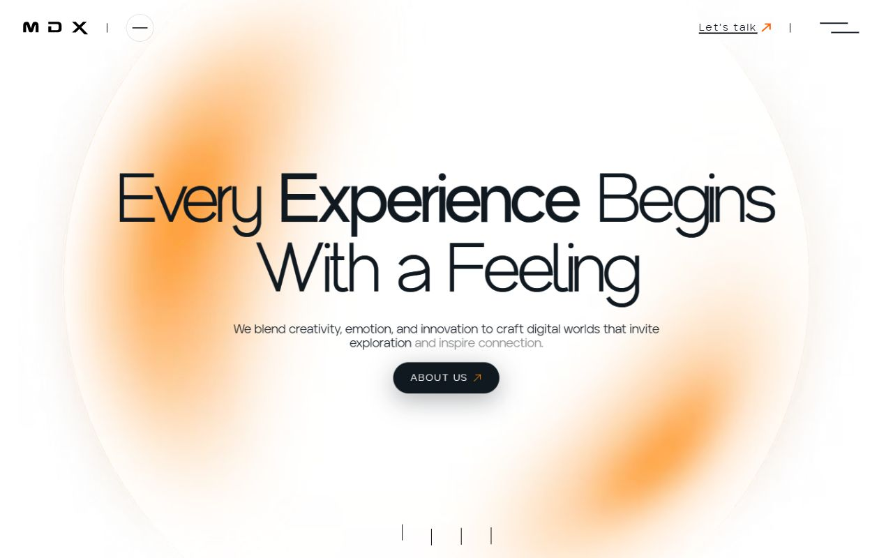
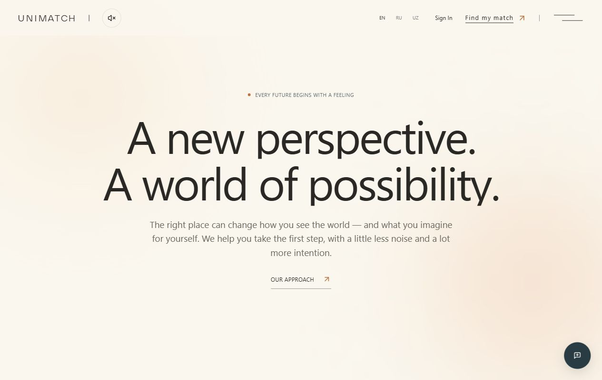
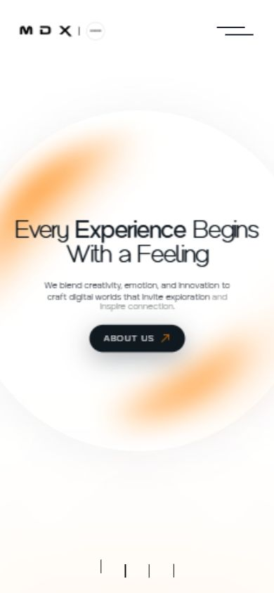
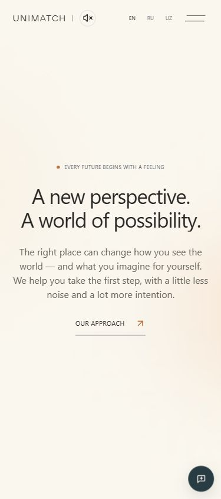
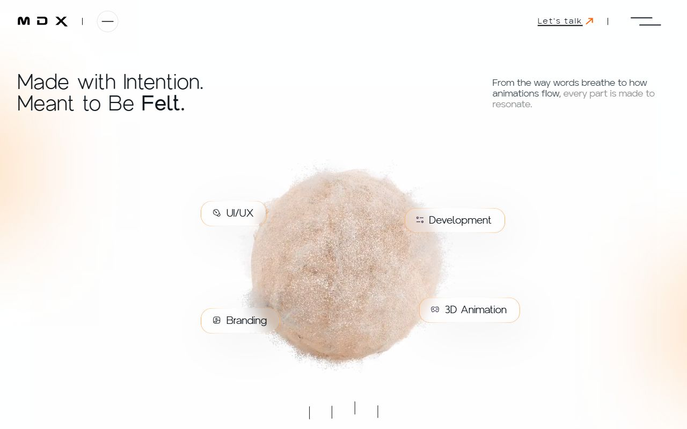
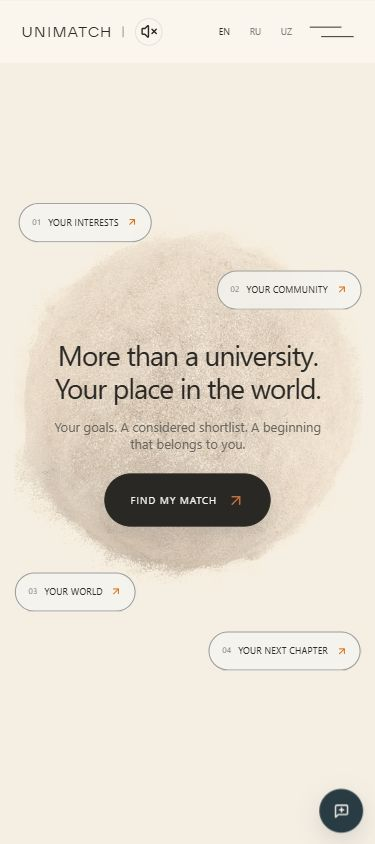
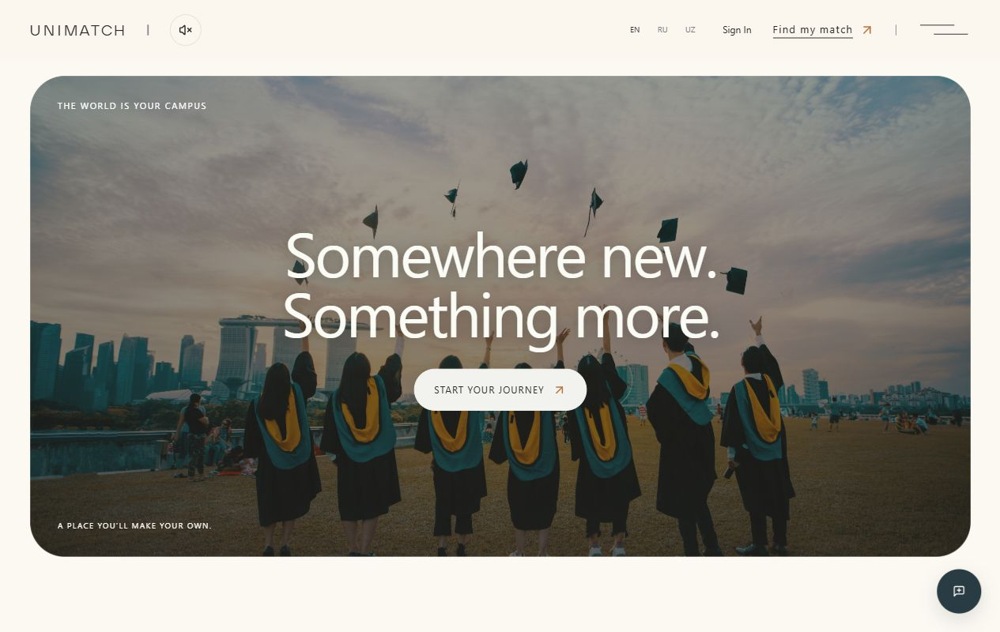
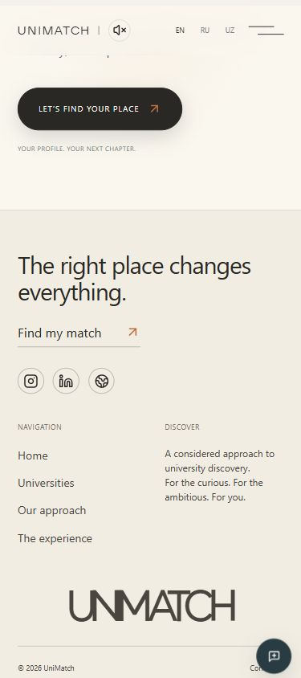

# MDX: разбор движения и перенос в UniMatch

Референс: https://mdx.so/ . Наблюдения в настоящем браузере 2026-10-16, окна 1280×800 и мобильное 390×844. Пройдены секции от выхода из первой 3D-сцены до конца футера и обратно, небольшими шагами. Мобильная проверка — адаптивное окно браузера, не физический телефон.

## Что наблюдалось

| Секция MDX | Как появляется и меняется текст | Закрепление, переход и обратный скролл |
| --- | --- | --- |
| Выход из первой 3D-сцены | Текст героя растворяется при уходе сцены. | Перед выходом сцена долго закреплена; шапка остаётся фиксированной. При возврате герой восстанавливается. |
| Every Experience Begins With a Feeling | Заголовок целиком, абзац и кнопка отдельно. В DOM заголовка нет разбиения на буквы или слова. У блоков разные вертикальные входы и прозрачность. Изменение масштаба, размытия или цвета самого текста не подтверждено. | Вход завершается после появления секции; при уходе уменьшается прозрачность всей композиции. При скролле назад она возвращается. Вокруг — светлая круглая поверхность и локальные размытые янтарные пятна. |
| From Ideas to Impactful Experiences | Единый центрированный заголовок, отдельный абзац. Сверху мягкая засветка и дуга. Побуквенное появление не наблюдалось. | Отдельный вход, затем растворение секции. При возврате измерена прозрачность 0 → .135 → 1 на широком экране и 0 → .276 → 1 на мобильном. |
| Showreel | Подпись единым блоком; медиа раскрывается из узкого окна в широкую рамку со скруглениями. | На части перехода медиа закреплено. При возврате рамка снова сужается. Загрузка Vimeo менялась; содержимое ролика не использовано как доказательство движения его рамки. |
| Made with Intention / We Build Experiences | На компьютере верхний заголовок слева, абзац справа; на мобильном — по центру друг под другом. Затем верхний текст исчезает, появляется центральный. Сфера слегка меняет размер, подписи расходятся наружу. | Эта часть непрерывно следует за скроллом и обращается назад. Сцена освобождается перед проектами. Побуквенная анимация не наблюдалась. |
| Проекты | Цельный заголовок, строка фильтров, изображения и цельные подписи карточек. На широком экране две колонки; мобильная композиция уже. | Обычный поток после освобождения сцены; шапка фиксирована. Закреплённый стек карточек, изменение масштаба/размытия текста и появление по словам не подтверждены. |
| Контакты | Заголовок, пояснение и читаемая форма. Две колонки на компьютере становятся вертикальной композицией на мобильном. Светлое персиковое свечение вокруг панели. | Обычный поток к футеру. Закрепление формы или непрерывная трансформация текста не подтверждены; при возврате та же композиция. |
| Футер | Цельная вводная фраза, навигация, крупный логотип и копирайт. | Обычный поток. Отдельное закрепление футера и побуквенное появление не подтверждены. |

У первых экранов наблюдается автоматическое доведение прокрутки к секции. Поэтому пройденное расстояние не равно длительности входной анимации. По неподвижному снимку нельзя надёжно установить easing или точную длительность.

Браузер сообщает `prefers-reduced-motion: reduce`, но MDX всё равно показывал морфинг сцены, плавный скролл и растворения. Это описание фактически полученного поведения, не утверждение о всех режимах сайта. DOM использован для проверки структуры текста; конкретная библиотека MDX не установлена и здесь не приписывается.

## Первый законченный фрагмент и сравнение

Сначала реализованы выход героя → крупная вводная фраза → следующий текстовый экран. При одинаковом широком окне сравнивались полностью открытые заголовки: у MDX верх заголовка около 250 px, у UniMatch после коррекции около 267 px при соответствующем положении секции. Первый экран получил больше вертикального пространства; на мобильном остаётся один экран и естественные переносы. Карточки ценностей перенесены ниже медиа, чтобы не прерывать первые две фразы.

Проверка обнаружила и исправила преждевременное исчезновение героя во время закреплённой сцены. Выход теперь отсчитывается от приближения следующей секции. Поздняя загрузка 3D-сцены получает приоритет пересчёта закрепления, чтобы смена размера окна не оставляла героя невидимым.

После сравнения подход распространён дальше: раскрытие и короткое закрепление медиа, обратимая смена текста/раздвижение подписей в сцене на компьютере и мобильном. Каталог и футер оставлены в обычном потоке, как наблюдалось у референса.

## Реализация

- `Landing.jsx`: сохранён DOM текста и содержание трёх языков, добавлен поясняющий абзац второй фразы, переставлены карточки ценностей.
- `usePageMotion.js`: цельные входы заголовков и отдельных абзацев; обратимые выходы; медиа-рамка и закрепление; адаптивная сцена. Первые два текстовых экрана мягко доводятся по направлению после остановки колеса/жеста через существующий экземпляр Lenis. Доведение прерывается новым вводом, не обрабатывает клавиатуру и не действует при открытом меню/диалоге.
- `HeroExplorer.jsx`: приоритет пересчёта лениво загружаемого закрепления.
- `story.css`: молочно-кремовая основа, тёплый графит, локальные янтарные/персиковые засветки, светлый футер, адаптивная композиция и контраст текста над фотографией. CSS подготовлен Luna, интеграция и исправления выполнены ведущим агентом.

Использованы уже установленные GSAP/ScrollTrigger и Lenis. Новые библиотеки не добавлялись. SplitText не нужен: наблюдаемый вход цельных заголовков сохраняет естественные переносы и семантику. Режим уменьшенного движения отключает плавный скролл, доведение, закрепления и появления; все тексты видимы сразу.

## Проверено

- Полное движение проверено на отдельном локальном стенде, который имитирует `no-preference` для JS и CSS при системном `reduce`; тестовая настройка находится только в игнорируемой `.tmp/` и не входит в продуктовую сборку.
- Вход/выход и возврат первого фрагмента, широкая и мобильная сцена, раскрытие/сужение медиа, поток каталога и светлого футера; смена широкого/мобильного размера и возврат к видимому герою.
- Доведение: широкий первый экран стабилизируется на y=2480, следующий на y≈3520; обратный ввод возвращает первый. На мобильном возврат стабилизируется на y=1688. Открытое меню сохраняло y=1688 при прокрутке.
- Настоящий `reduce` на обычном сервере: 0 закреплений, нет скрытых заголовков/абзацев. Русский и узбекский тексты проверены на 390 px; на 320 px — нет горизонтального переполнения, обрезанных строк и символов замены.
- После чистой загрузки и переключения RU → EN новых ошибок приложения не обнаружено. Изменение числа хуков во время горячего обновления тестового стенда вызвало временную ошибку Fast Refresh; после перезагрузки она не воспроизводилась.
- Сборка, lint и no-emit typecheck проходят; окончательные результаты записаны в журнале задачи. Расчёты подбора, API и авторизация этим изменением не затронуты.

Физические устройства и жесты на них, производительность на слабых GPU и все браузерные движки не проверены. Новая версия не публиковалась в production. Снимки настоящие; часть захватов во время движения имеет ограниченную резкость браузерного инструмента.

## Ключевые состояния

MDX и UniMatch, первая крупная фраза, 1280×800:

Мобильный референс и UniMatch:

Поздние состояния:

